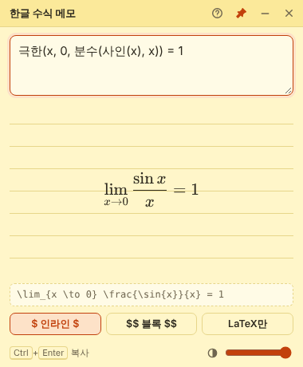

<p align="center">
  
</p>

<h1 align="center">한글 수식 메모</h1>

<p align="center">
  <b>루트(3+1)</b> 이라고 쓰면 <b>√(3+1)</b> 이 되는, 화면 위에 붙여 두는 스티커 메모형 수식 입력기<br />
  마크다운(Notion, Obsidian, GitHub, Typora 등)에 바로 붙여 넣을 수 있는 <code>$LaTeX$</code> 를 만들어 줍니다.
</p>

<p align="center">
  
</p>

## 내려받기

[**Releases**](../../releases/latest) 페이지에서 내 컴퓨터에 맞는 파일을 받으세요.

| 운영체제 | 파일 |
| --- | --- |
| Windows (설치형) | `HangulMathMemo-버전-win-x64.exe` |
| Windows (설치 없이 실행) | `HangulMathMemo-버전-portable.exe` |
| macOS (M1 이후) | `HangulMathMemo-버전-mac-arm64.dmg` |
| macOS (인텔) | `HangulMathMemo-버전-mac-x64.dmg` |
| Linux | `HangulMathMemo-버전-linux-x86_64.AppImage` |

> 코드 서명을 하지 않은 프로그램이라 처음 실행할 때 경고가 뜰 수 있습니다.
> - **Windows**: "Windows의 PC 보호" 창에서 **추가 정보 → 실행**
> - **macOS**: 앱을 **우클릭 → 열기**, 또는 시스템 설정 → 개인정보 보호 및 보안 → **그래도 열기**

## 쓰는 법

말하듯이 **이름(내용)** 으로 쓰면 됩니다. 쉼표로 칸을 나눕니다.

| 이렇게 쓰면 | 이렇게 됩니다 |
| --- | --- |
| `루트(3+1)` | $\sqrt{3+1}$ |
| `루트[3](8)` 또는 `루트(3, 8)` | $\sqrt[3]{8}$ |
| `분수(1, 2)` | $\frac{1}{2}$ |
| `x제곱 + y세제곱` | $x^{2} + y^{3}$ |
| `거듭제곱(e, x+1)` | ${e}^{x+1}$ |
| `첨자(a, n+1)` | ${a}_{n+1}$ |
| `절댓값(x-3)` | $\left\|x-3\right\|$ |
| `적분(0, 1, x제곱 dx)` | $\int_{0}^{1} x^{2} dx$ |
| `시그마(k=1, n, k)` | $\sum_{k=1}^{n} k$ |
| `극한(x, 0, 분수(사인(x), x))` | $\lim_{x \to 0} \frac{\sin{x}}{x}$ |
| `로그(2, 8)` · `자연로그(x)` | $\log_{2}{8}$ · $\ln{x}$ |
| `미분(y, x)` · `편미분(f, x)` | $\frac{dy}{dx}$ · $\frac{\partial f}{\partial x}$ |
| `조합(5, 2)` · `순열(5, 2)` | ${}_{5}\mathrm{C}_{2}$ · ${}_{5}\mathrm{P}_{2}$ |
| `벡터(a)` · `바(x)` · `모자(x)` | $\vec{a}$ · $\overline{x}$ · $\hat{x}$ |
| `행렬(1, 2; 3, 4)` | $\begin{pmatrix} 1 & 2 \\\\ 3 & 4 \end{pmatrix}$ |
| `연립(x+y=3, x-y=1)` | 연립방정식 중괄호 |
| `글자(속도) = 분수(거리, 시간)` | $\text{속도} = \frac{\text{거리}}{\text{시간}}$ |

**괄호 없이 쓰는 말**

- 그리스 문자: 알파 베타 감마 델타 엡실론 세타 람다 뮤 파이 시그마 오메가 …
- 연산·관계: 곱하기 나누기 점곱 플마 이하 이상 같지않다 근사 무한대 화살표 따라서
- 기하·집합: 각 삼각형 도(°) 수직 평행 원소 부분집합 합집합 교집합 공집합
- 기호도 됩니다: `*` → ×, `<=` → ≤, `>=` → ≥, `!=` → ≠, `->` → →, `x^(2n)` → x²ⁿ
- `\frac{1}{2}` 같은 LaTeX 를 직접 섞어 써도 그대로 통과합니다.
- 여러 줄로 쓰면 줄마다 한 식으로 묶어 줍니다.

**단축키**

| 키 | 동작 |
| --- | --- |
| `Ctrl` + `Enter` (맥: `⌘` + `Enter`) | 마지막으로 쓴 형식으로 복사 |
| `Ctrl` + `Shift` + `M` | 어디서든 메모 숨기기 / 보이기 |
| `F1` | 문법 도움말 |

제목줄의 핀 버튼으로 **항상 위에 고정**을 켜고 끌 수 있고, 아래 슬라이더로 투명도를 조절합니다. 창 위치·크기·마지막 입력은 자동으로 기억됩니다.

## 직접 실행 / 개발

[Node.js](https://nodejs.org) 20 이상이 필요합니다.

```bash
npm install     # 처음 한 번
npm start       # 앱 실행
npm test        # 변환 규칙 테스트
npm run dist    # 내 컴퓨터용 설치 파일 만들기 (dist 폴더)
```

| 파일 | 하는 일 |
| --- | --- |
| `src/parser.js` | 한글 → LaTeX 변환 규칙 (새 함수는 `FUNCS`, 새 낱말은 `WORDS` 에 추가) |
| `src/renderer.js` | 입력, 미리보기, 복사, 도움말 |
| `main.js` | 창 만들기, 항상 위 고정, 단축키, 설정 저장 |
| `.github/workflows/release.yml` | 태그를 올리면 설치 파일 자동 빌드 |

### 새 버전 배포하기

```bash
# package.json 의 version 을 올린 뒤
git commit -am "v0.2.0"
git tag v0.2.0
git push origin main --tags
```

몇 분 뒤 GitHub **Actions** 가 Windows·macOS·Linux 설치 파일을 만들어 **Releases** 에 올려 줍니다.

## 라이선스

MIT · 수식 렌더링은 [KaTeX](https://katex.org) (MIT) 를 사용합니다.
